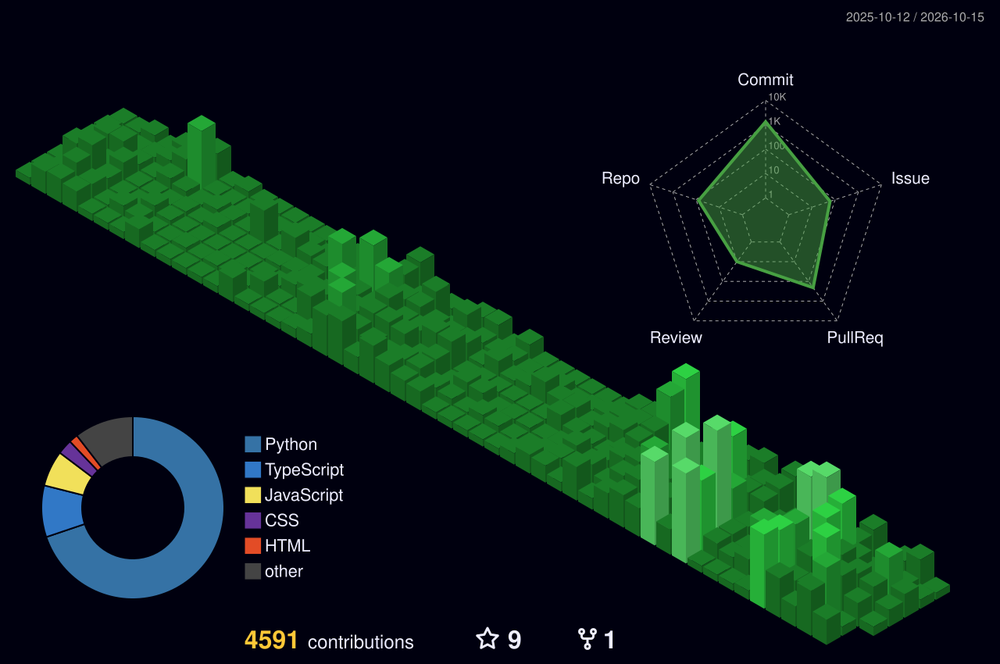

<div align="center">

<!-- HEADER -->


[](https://github.com/tysoncung)

<br/>

<!-- SOCIAL BADGES -->
<a href="https://github.com/tysoncung?tab=followers">
  
</a>


<br/><br/>

<a href="https://twitter.com/tscung"></a>
<a href="https://tiktok.com/@tysoncung"></a>
<a href="https://www.linkedin.com/in/tysoncung/"></a>
<a href="https://youtube.com/@tysoncung"></a>
<a href="https://dev.to/tyson_cung"></a>
<a href="https://tysoncung.gumroad.com"></a>
<a href="https://medium.com/@tysoncung"></a>
<a href="mailto:tyson@hivo.co"></a>

</div>

<br/>

<!-- ABOUT ME -->
## About Me

```python
class TysonCung:
    def __init__(self):
        self.role = "Chief Product Officer"
        self.company = "hivo.co"
        self.location = "Perth, Australia"
        self.education = ["M.Tech Software Engineering, NUS",
                           "CDAIO (Chief Data & AI Officer), NUS"]

    @property
    def skills(self):
        return {
            "languages": ["Python", "TypeScript", "Go", "Rust"],
            "cloud": ["AWS (4x Certified)", "Kubernetes", "Docker", "Terraform"],
            "ai_ml": ["PyTorch", "LangChain", "RAG", "AI Agents"],
            "databases": ["PostgreSQL", "Redis", "Vector DBs"]
        }

    @property
    def open_source_impact(self):
        return "600,000+ stars on contributed projects"
```

---

<!-- SNAKE ANIMATION -->
<div align="center">

## Contribution Graph

<picture>
  <source media="(prefers-color-scheme: dark)" srcset="https://raw.githubusercontent.com/tysoncung/tysoncung/output/snake-dark.svg" />
  <source media="(prefers-color-scheme: light)" srcset="https://raw.githubusercontent.com/tysoncung/tysoncung/output/snake.svg" />
  
</picture>

</div>

---

## Open Source Impact

<div align="center">

### Contributor to mass-adopted projects with **600,000+ combined stars**

</div>

<table>
<tr>
<td width="50%">

| Project | Stars |
|---------|:-----:|
| [**huggingface/transformers**](https://github.com/huggingface/transformers) |  |
| [**ollama**](https://github.com/ollama/ollama) |  |
| [**langchain**](https://github.com/langchain-ai/langchain) |  |
| [**dify**](https://github.com/langgenius/dify) |  |
| [**meilisearch**](https://github.com/meilisearch/meilisearch) |  |
| [**microsoft/autogen**](https://github.com/microsoft/autogen) |  |

</td>
<td width="50%">

| Project | Stars |
|---------|:-----:|
| [**streamlit**](https://github.com/streamlit/streamlit) |  |
| [**openai-python**](https://github.com/openai/openai-python) |  |
| [**awesome-nodejs**](https://github.com/sindresorhus/awesome-nodejs) |  |
| [**tldr-pages**](https://github.com/tldr-pages/tldr) |  |
| [**pandas**](https://github.com/pandas-dev/pandas) |  |
| [**directus**](https://github.com/directus/directus) |  |

</td>
</tr>
</table>

---

## Latest Videos 🎥

<div align="center">

<a href="https://youtube.com/@tysoncung?sub_confirmation=1">
  
</a>

</div>

<div align="center">

<a href="https://youtu.be/1r47iYuENPI"></a> <a href="https://youtu.be/JYNblcTN8Ks"></a> <a href="https://youtu.be/Zn1xQiHyoFI"></a>

<br/>

<a href="https://youtu.be/9V7rd0JMBXM"></a> <a href="https://youtu.be/GtCgoXCp75s"></a> <a href="https://youtu.be/2rRsdSIYJNg"></a>

<br/>

</div>

<sub>Auto-updated from [https://youtube.com/@tysoncung](https://youtube.com/@tysoncung)</sub>


## Recent Activity

<div align="center">

### 🚀 Recently Shipped

</div>

- 🔀 **[Claude Config Switcher](https://github.com/tysoncung/claude-config-switcher) v1.2.3** - VS Code extension for separate Claude Code accounts per window or project, now on the [VS Code Marketplace](https://marketplace.visualstudio.com/items?itemName=TysonCung.cc-config-switcher) and [Open VSX](https://open-vsx.org/extension/tysoncung/cc-config-switcher) (Cursor, Windsurf, VSCodium)
- 🧰 **[awesome-vibe-coding](https://github.com/tysoncung/awesome-vibe-coding)** - 8 new AI coding tools added, including Orbi, Frink, OrcaReplay and Oh My Android

<div align="center">

### 🔥 Latest Contributions

</div>

- 🦜 **LangChain.js** - Strip the type field from Google executableCode and codeExecutionResult parts ([PR #10586](https://github.com/langchain-ai/langchainjs/pull/10586))
- 👁️ **Kornia** - Add correlate2d/convolve2d/correlate3d/convolve3d filter aliases ([PR #3604](https://github.com/kornia/kornia/pull/3604))
- ☁️ **Apache Airflow** - Widen type hint for DagRun.get_task_instances state parameter ([PR #67880](https://github.com/apache/airflow/pull/67880))
- 🤖 **BerriAI/litellm** - Propagate upstream status code in proxy exception handler ([PR #29402](https://github.com/BerriAI/litellm/pull/29402))
- 🧠 **Microsoft AutoGen** - Fix LangChainToolAdapter pydantic schema error for tools with internal fields ([PR #7808](https://github.com/microsoft/autogen/pull/7808))
- 🧠 **Microsoft AutoGen** - Fix typos: overriden → overridden, independantly → independently ([PR #7809](https://github.com/microsoft/autogen/pull/7809))
- 📋 **Appwrite** - Validate session expiry during JWT authentication ([PR #12505](https://github.com/appwrite/appwrite/pull/12505))
- 🌬️ **Apache Airflow** - Fixed duplicate Date headers in webserver responses ([PR #65086](https://github.com/apache/airflow/pull/65086))
- 📦 **pip-tools** - Added table of contents to README + shell completion docs ([PR #2370](https://github.com/jazzband/pip-tools/pull/2370), [PR #2371](https://github.com/jazzband/pip-tools/pull/2371))
- 🌊 **Streamlit** - Added border-radius rounding to st.video and st.map ([PR #14626](https://github.com/streamlit/streamlit/pull/14626))

---

## Awesome Lists I Maintain

> Helping thousands of developers find the best tools

<div align="center">

| | List | Description |
|:--:|------|-------------|
|  | [**awesome-vibe-coding**](https://github.com/tysoncung/awesome-vibe-coding) | 230+ AI coding tools - Claude Code, Cursor, Copilot, Windsurf |
|  | [**awesome-ai-gadgets**](https://github.com/tysoncung/awesome-ai-gadgets) | CES 2026 AI wearables & hardware |
|  | [**awesome-claude-ai**](https://github.com/tysoncung/awesome-claude-ai) | Claude Opus 4.5 tools & resources |
|  | [**awesome-ai-agents**](https://github.com/tysoncung/awesome-ai-agents) | AI agent frameworks & browser automation |
|  | [**awesome-n8n**](https://github.com/tysoncung/awesome-n8n) | 380+ workflow automation resources |
|  | [**awesome-devops-tools**](https://github.com/tysoncung/awesome-devops-tools) | Modern DevOps toolchain |

**[View all 20+ awesome lists](https://github.com/tysoncung?tab=repositories&q=awesome)**

</div>

---

## Tech Stack

<div align="center">

### Languages


### Cloud & DevOps


### Frameworks & Tools


### AI/ML & Data


</div>

---

## GitHub Stats

<div align="center">


</div>

<details>
<summary><b>More Stats</b></summary>
<div align="center">


</div>
</details>

<details>
<summary><b>3D Contribution Graph</b></summary>
<div align="center">



</div>
</details>

---

## My Products

<div align="center">

| | Product | Description |
|:--:|---------|-------------|
| :twisted_rightwards_arrows: | [**Claude Config Switcher**](https://github.com/tysoncung/claude-config-switcher) | VS Code extension: a different Claude Code account per window or project, from the status bar. [**VS Code Marketplace**](https://marketplace.visualstudio.com/items?itemName=TysonCung.cc-config-switcher) / [**Open VSX**](https://open-vsx.org/extension/tysoncung/cc-config-switcher). **Open Source** |
| :robot: | [**AI Platform AWS**](https://github.com/tysoncung/ai-platform-aws) | Production AI platform — Gateway, SDK, RAG, Agents. 6 providers, 112+ tests. **Open Source** |
| :electric_plug: | [**MCP Server Starter Kit**](https://github.com/tysoncung/mcp-server-starter) | Production MCP servers with auth, rate limiting, 5 tools, dual transport. [**Free**](https://github.com/tysoncung/mcp-server-starter) / [**Pro $49**](https://tysoncung.gumroad.com/l/mcp-starter-pro) |
| :thought_balloon: | [**Notion Agent Hub**](https://github.com/tysoncung/notion-agent-hub) | AI Agent Hub for Notion — orchestrate AI agents through Notion databases with human-in-the-loop approval. MCP-powered. **Open Source** |
| :zap: | [**Serverless NestJS Starter Pro**](https://tysoncung.gumroad.com/l/serverless-nestjs-starter) | Production-ready NestJS + AWS Lambda + CDK. 4 auth modes, DynamoDB, SQS, WAF. **$49** |
| :gear: | [**DDD Microservices Starter Kit**](https://tysoncung.gumroad.com/l/dddmsk) | Clean Architecture + DDD + Azure. **$39** |
| :wrench: | [**zapit**](https://www.npmjs.com/package/@tysoncung/zapit) | Generate NestJS CRUD APIs from Zod schemas. **npm** |
| :bar_chart: | [**Schema Dashboard**](https://github.com/tysoncung/schema-dashboard) | Generate CRUD dashboards from Zod schemas. Free + Pro |
| :video_game: | [**GameOn**](https://github.com/tysoncung/gameon) | Pickup game coordinator — WhatsApp bot + web. Next.js + MongoDB + Twilio. **Open Source** |
| :clapper: | [**ShortFactory Kids**](https://github.com/tysoncung/shortfactory-kids) | AI educational Shorts generator for children. Gemini 2.0 + Imagen 3 + Cloud TTS. **Open Source** |
| :page_facing_up: | [**excel-zod**](https://github.com/tysoncung/excel-zod) | Type-safe Excel reading & writing with Zod schemas. **Open Source** |
| :sunny: | [**Solar Arbitrage**](https://solar-arbitrage-web.vercel.app/) | Smart EV charging for AU solar owners. Free MVP |
| :battery: | [**EV Solar Calc**](https://github.com/tysoncung/ev-solar-calc) | Battery payback calculator for AU solar + EV owners. Free |

</div>

---

## Regen Engineering

<div align="center">

**[Regen Engineering](https://regen.engineering/) is an open methodology I'm developing for owning software as knowledge.**

*Knowledge is the asset. Code is the byproduct.*

The system knowledge is the versioned, governed source. Implementations are verified build artifacts that any capable AI can regenerate, at the smallest scope, on any stack. The [manifesto](https://regen.engineering/) is at v0.3 (draft).

| | Repo | What it is |
|:--:|------|------------|
| :scroll: | [**regen.engineering**](https://github.com/tysoncung/regen.engineering) | The manifesto and site |
| :card_file_box: | [**regen-engineering-schema**](https://github.com/tysoncung/regen-engineering-schema) | Knowledge schema and reference validator: Markdown plus YAML frontmatter, validated as a graph |
| :toolbox: | [**regen-engineering-skills**](https://github.com/tysoncung/regen-engineering-skills) | Reference implementation as agent skills |
| :recycle: | [**regen-engineering-demo**](https://github.com/tysoncung/regen-engineering-demo) | Two implementations, one contract suite, same knowledge: delete an implementation and regenerate it |
| :floppy_disk: | [**regen-engineering-stateful**](https://github.com/tysoncung/regen-engineering-stateful) | Reference system for REP-0005: what the method says about systems that own data |

**Writing about it:**
- [I deleted my source code and regenerated it in a different language](https://dev.to/tyson_cung/i-deleted-my-source-code-and-regenerated-it-in-a-different-language-17aa)
- [An agent documented my app, found 4 bugs I did not know about, then rebuilt it from the docs](https://dev.to/tyson_cung/an-agent-documented-my-app-found-4-bugs-i-did-not-know-about-then-rebuilt-it-from-the-docs-5bl9)
- [My tests passed 18 out of 18. The service deletes your database on startup](https://dev.to/tyson_cung/my-tests-passed-18-out-of-18-the-service-deletes-your-database-on-startup-4nhc)

</div>

---

## Placeforge: AI-Built Roblox Games

<div align="center">

**I'm building Placeforge, an AI agent that plans, builds, tests, and publishes Roblox games inside Roblox Studio.**

It composes from a library of 136 hand-crafted, headless-tested Luau kits across 17 families, verifies its own builds with a playtest-and-repair loop, and deploys through the Roblox Open Cloud API. The proof is live: these games were built by the agent, end to end.

| | Game | What the agent shipped |
|:--:|------|------------------------|
| 🐾 | [**Paws and Bubbles Daycare**](https://www.roblox.com/games/116146617626130) | Pet daycare: adoption, care stations, boutique, Best in Show contest, persistent saves, server-validated monetization |
| 🏝️ | [**Treasure Cove**](https://www.roblox.com/games/94845747826419) | Hidden-object hunt: a 700x700 island hiding 45 tiered treasures across a port village, shipwreck, and temple |

Every game has daily rewards, rotating daily quests, and atomic DataStore persistence, all composed from the same kit library. A third game (an Australian outback tycoon) is next.

</div>

---

## Writing

<div align="center">

<a href="https://tysoncung.gumroad.com"></a>

**Latest articles:**
- [Apple M6: Why There Will Never Be an M6 Pro](https://dev.to/tyson_cung/apple-m6-why-there-will-never-be-an-m6-pro-4fdf)
- [The Vibe Coding Landscape Changed Under Our Feet. Here Is the Map.](https://dev.to/tyson_cung/the-vibe-coding-landscape-changed-under-our-feet-here-is-the-map-21kn)
- [The engineering behind an AI agent that ships real Roblox games](https://dev.to/tyson_cung/the-engineering-behind-an-ai-agent-that-ships-real-roblox-games-k50)
- [Can a Mac mini run Kimi K3? I did the memory math](https://dev.to/tyson_cung/can-a-mac-mini-run-kimi-k3-i-did-the-memory-math-4bp3)
- [How to Block Dangerous Commands with Claude Code Hooks](https://dev.to/tyson_cung/how-to-block-dangerous-commands-with-claude-code-hooks-g5o)
- [My tests passed 18 out of 18. The service deletes your database on startup](https://dev.to/tyson_cung/my-tests-passed-18-out-of-18-the-service-deletes-your-database-on-startup-4nhc)
- [An agent documented my app, found 4 bugs I did not know about, then rebuilt it from the docs](https://dev.to/tyson_cung/an-agent-documented-my-app-found-4-bugs-i-did-not-know-about-then-rebuilt-it-from-the-docs-5bl9)
- [I deleted my source code and regenerated it in a different language](https://dev.to/tyson_cung/i-deleted-my-source-code-and-regenerated-it-in-a-different-language-17aa)
- [Claude Code vs Cursor vs Copilot: How to Choose the Right AI Coding Assistant in 2026](https://dev.to/tyson_cung/claude-code-vs-cursor-vs-copilot-how-to-choose-the-right-ai-coding-assistant-in-2026-24jd)

[**All articles on dev.to →**](https://dev.to/tyson_cung)

</div>

---

## Support My Work

<div align="center">

If you find my open source work helpful, consider supporting me!

<a href="https://buymeacoffee.com/tysoncungu">
  
</a>

</div>

---

<!-- QUOTE -->
<div align="center">

### Random Dev Quote


</div>

---

<!-- FOOTER -->
<div align="center">


**Perth, Australia** | M.Tech Software Engineering, NUS | CDAIO Cert, NUS | CPO at [hivo.co](https://hivo.co)

<sub>Last updated by GitHub Actions</sub>

</div>

<!-- Last updated: 2026-10-30 05:04:07 UTC -->
